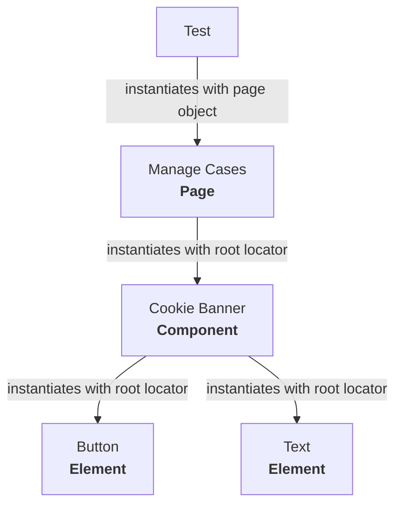

# Page Object Model

A Page Object Model (POM) is a standard design pattern in test automation aimed at reducing code duplication and maintenance. Implementations of POMs can vary; these guidelines establish design standards for Page Object Model (POM) test automation within HMCTS Quality Engineering (QE). Adopting these standards ensures maintainable, readable, and robust test suites across service teams. 

## 1. Core Principles & Architecture 

To keep code maintainable and organised: 
  
- **Decouple Test Logic from Page Details:** Tests state what behavior is being verified; Page Objects handle how to interact with the UI. 
  
- **Single Responsibility:** Each Page Object class represents a distinct UI page or reusable logical component (e.g., navigation header, modal dialog). 

- **Return Next Page Objects on Navigation:** Actions that trigger page transitions should return a new instance of the target Page Object.
 
## 2. Structure

The POM structure is made up as below:

```sh
├── page-objects/            # Page objects
├──── components/            # Common components shared across pages
├──── elements/              # Common elements that could be found in a page or in a component
├──── pages/                 # Unique pages that may contain their own locators
```

### Elements

Elements can exist on multiple components. These typically boil down to the raw HTML elements such as inputs, raw text and buttons etc. Sometimes it can be useful to have an element class that allows you to store logic related to specific elements separately.

For example with checkboxes you may want to store locators, custom assertions or handling logic. You can then refer to this class rather than duplicating the code for each test.

### Components

Components can exist on multiple pages, they are mostly made up of elements or could also include other components. Likewise with elements, you may also want to store handling logic or custom assertions for components.

A common example of this within HMCTS is the "cookie banner". This component can appear on every page and is made up of text elements and buttons.

### Pages

Finally, pages are essentially made up of elements are components. You may also choose to store unique locators in these pages as well (if they are not part of a component). These will be at a higher level than elements or components and should mostly be kept lightweight.

## 3. How to combine Elements, Components and Pages

Using the above examples, we could model it like so:



Then for example, your test using the page (as a fixture) can inherit any components or elements that are used in that page.
See example [here](https://github.com/hmcts/tcoe-playwright-example/blob/master/playwright-e2e/tests/case-list-professional.spec.ts#L28)

## 4. Base Page

In addition to the above, there is a ["base page"](https://github.com/hmcts/tcoe-playwright-example/blob/master/playwright-e2e/page-objects/base.ts). This acts as a parent to the other pages where they also inherit the "page" object e.g. [here](https://github.com/hmcts/tcoe-playwright-example/blob/master/playwright-e2e/page-objects/components/cui/cui-case-list.component.ts#L17) a benefit of this is that you can avoid declaring locators inside the constructor and instead make the locators a class property instead.

## 5. File & Class Naming Conventions

### Page Objects 

**What?** Represents a distinct UI page and handles how to interact with this page. 

**File Name:** Use kebab-case with a .page.ts suffix (e.g., case-details.page.ts)  

**Class Name:** Use PascalCase inside the file (e.g., class CaseDetailsPage)   

### Components  

**What?** Represents a reusable, independent UI element (e.g., tables, search bars, navbars) that appears across multiple pages. Handles interactions for that specific element in one centralized place to avoid repeating code across page objects. 

**File Name:** Use kebab-case with a .component.ts suffix (e.g., header-navigation.component.ts)  

**Class Name:** Use PascalCase inside the file (e.g., class HeaderNavigationComponent)  

### Test Files 

**What?** Contains the actual test cases and assertions. Imports page objects and components to execute user workflows and verify expected behaviors. 

**File Name:** Use kebab-case with a .spec.ts suffix (e.g., create-case.spec.ts) 

### Test data 

**What?** Holds static or dynamic input data (e.g., user payloads, form inputs, configuration values) used during test execution to keep test files clean and separate logic from data. 

**File Name:** Use kebab-case with a .data.ts or .json suffix (e.g., create-case.data.ts or user-roles.json). 

**Class Name:** Use camelCase for exported objects or functions, or PascalCase for type interfaces (e.g., export const validCaseData or export interface CasePayload). 

## 6. What Belongs in a Page Object

To keep Page Objects clean and purposeful, divide responsibilities according to these boundaries:

### What to Include
**Readonly Locators:** User-facing selectors scoped to that page.

**Encapsulated Action Methods:** Multi-step user interactions exposed as logical functions (e.g., submitClaim(), filterByStatus(status)).

**Internal State Verifications:** Validation methods that confirm the page itself has reached a stable, interactive state before proceeding.

**Navigation Handlers:** Methods triggering transitions that return a new instance of the destination Page Object.

### What NOT to Include
**Test Assertions (expect()):** Do not place final test assertions inside page methods. Keep assertions inside .spec.ts test files so failure messages clearly link to the test definition.

**Hardcoded Test Data:** Keep test payloads, user credentials, and environment-specific strings inside dedicated test-data files or fixtures.

**Low-Level Timing Hacks:** Never use page.waitForTimeout() or arbitrary sleep calls; rely on Playwright's built-in web assertions and auto-waiting locators.


## 7. Element Encapsulation & Locators 

- **User-Facing Locators First:** Always prefer Playwright's resilient, user-centric locators (getByRole, getByText, getByLabel) over brittle XPath or CSS selectors.  

- **Declare Locators as Class Properties:** Define locators as readonly properties at the top of the Page Object class for centralized maintenance.  

- **Expose Locators for Assertions, Encapsulate Actions:** Keep locators readable for test assertions (expect()), but wrap multi-step interactions inside functional methods (e.g., submitForm(), enterCaseTitle()).   

## 8. Do's and Don'ts

| Do | Don't |
| --- | --- |
| Use Playwright native locators (`getByRole`, `getByLabel`, `getByText`). | Hardcode CSS/XPath selectors (`div > ul > li:nth-child(2)`). |
| Return new Page Objects upon navigation actions. | Put test assertions (`expect()`) inside Page Objects. |
| Extract repeated UI elements (headers, footers) into reusable components. | Duplicate locator definitions across multiple page classes. |
| Expose locators as `readonly` properties for test assertions. | Perform actions (`.click()`, `.fill()`) directly in test scripts. |
| Use `async`/`await` consistently on all interaction methods. | Hardcode static test data inside page classes. |